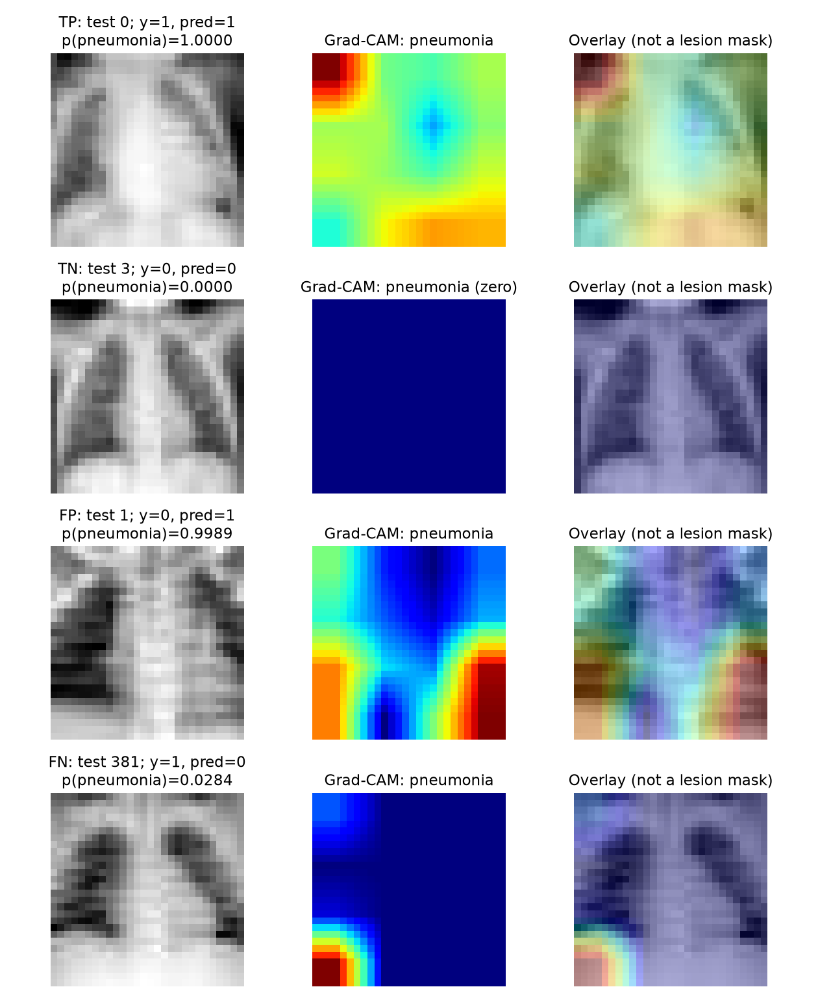

# PneumoniaMNIST — Medical AI self-learning tutorial

An AI-assisted learning study of image classification, loss functions and residual networks. The learner directed questions and interpreted experiments; AI assisted implementation and explanations. This is an exploratory tutorial, not a clinically validated diagnostic tool or a confirmed exact paper replication.

[](https://colab.research.google.com/github/SaiKiranKumarNalla/Medical-AI-self-learning-tasks/blob/main/pneumoniamnist/pneumoniamnist_study.ipynb)

The notebook is a corrected, unexecuted teaching workflow. Training and final test evaluation are opt-in. Historical results are recorded separately below.

## What this project teaches
- Dataset inspection, class imbalance, tensors and Python OOP.
- A small-image ResNet-18 and a plain network without residual shortcuts.
- Standard cross-entropy, weighted cross-entropy and focal loss.
- Validation-based checkpoint selection, sensitivity/specificity and error analysis.
- Why test reuse, duplicate images and misleading explanations limit conclusions.

## Data and method
[PneumoniaMNIST](https://medmnist.com/) provides 28×28 grayscale chest images with labels 0=normal and 1=pneumonia. Train/validation/test contain 4,708/524/624 images. These are image counts, not verified independent patient counts. Use the official data and source citations; retain their licensing/attribution requirements. No raw data is included here.

The saved ResNet uses a 3×3 stride-1 stem without initial max-pooling, stages of widths 64/128/256/512 and two blocks per stage. It has 11,168,706 parameters. PlainNet removes identity and projection shortcuts and has 10,994,882 parameters: it is not parameter matched.

Historical runs used Adam, initial LR 0.001 and MultiStepLR milestones 50/75. Baseline ran 100 epochs; extensions used validation-AUC early stopping. Changed stopping policies mean these are not isolated loss/architecture comparisons.

## Verified historical results
CPU inference from the existing checkpoints, threshold 0.5, positive class=pneumonia. No retraining was performed during review. See results/verified_metrics.json and per-image prediction CSVs.

| Saved model | AUC | Accuracy | Sensitivity | Specificity | TN / FP / FN / TP | Parameters |
|---|---:|---:|---:|---:|---|---:|
| best_resnet18_val_auc | 0.9480 | 84.62% | 98.97% | 60.68% | 142 / 92 / 4 / 386 | 11,168,706 |
| best_resnet18_weighted | 0.9551 | 87.98% | 99.23% | 69.23% | 162 / 72 / 3 / 387 | 11,168,706 |
| best_resnet18_focal | 0.9511 | 89.10% | 94.87% | 79.49% | 186 / 48 / 20 / 370 | 11,168,706 |
| best_plainnet18 | 0.9675 | 89.90% | 98.46% | 75.64% | 177 / 57 / 6 / 384 | 10,994,882 |

## Important limitations discovered during review
- Eight exact image hashes overlap between training and validation; none overlap with test. Patient independence cannot be established from the NPZ. Historical results preserve the official split and its limitation.
- Test results were examined while proposing further experiments. Treat the results as exploratory, not an untouched confirmatory evaluation. Fixing code cannot undo test exposure.
- Single runs and different stopping budgets do not establish superiority of focal loss, pruning or removal of residual connections. Compare multiple seeds with a fixed selection protocol in future work.
- Grad-CAM is a coarse attribution visualisation, not evidence of a particular lesion, diagnostic mechanism or anatomical cause. Zero maps are reported honestly.
- Prior pruning tables conflicted and lacked a standalone generating script/checkpoint. They are excluded from the verified results. Unstructured zeros do not by themselves reduce dense tensor storage or measured latency.

## Run
Python 3.10+; install a PyTorch build appropriate to your platform, then:

```bash
pip install -r requirements.txt
python train_replication.py --output-dir runs/baseline
python run_weighted_experiment.py --output-dir runs/weighted
python run_focal_experiment.py --output-dir runs/focal
python run_residual_ablation.py --output-dir runs/plain
```

Scripts download the official dataset when absent and select CUDA, then MPS, then CPU. Run directories must be new, preventing accidental overwrite of historical weights. `--epochs 1` is a smoke-run budget, not a reproduction. Paths for data are relative to the script; output paths are resolved from your working directory.

Only the baseline supports resume:
```bash
python train_replication.py --output-dir runs/baseline --resume
```
New checkpoints preserve random-generator state. Older checkpoints without it are rejected for resume. Hardware/library nondeterminism can still prevent bitwise equivalence across systems. Historical checkpoints are excluded from Git; rerunning scripts creates new results, not guaranteed identical numbers.

`python audit_results.py` regenerates verified tables/predictions and the Grad-CAM figure when the original four checkpoints are present under checkpoints/. It does not train models. Public readers without those weights can inspect the saved CSVs; these CSVs reproduce metrics but do not independently establish the historical training process.



## Files and provenance
- PROJECT_REPORT.md: corrected interpretation and review findings.
- results/: machine-readable post-hoc verification.
- audit_results.py: evaluation and attribution figure source.
- Four training scripts: historical model definitions with portability/reporting repairs.
- figures/: historical learning illustrations; see figures/README.md for verification status.
- Conversation files are private and excluded from Git, including CONVERSATION_HISTORY.md.

Reference: [Yang et al., MedMNIST v2, Scientific Data (2023)](https://doi.org/10.1038/s41597-022-01721-8). Exact paper row, upstream code revision and provenance must be reconciled before any replication claim. This tutorial does not claim a new architecture or clinical benefit.

## Corrected future experiment protocol
New runs remove exact training-image matches from validation by default. Use --official-validation only to deliberately retain the historical official split and disclose its overlap. This changes checkpoint selection and cannot retroactively fix old results. Test evaluation is withheld by default; --evaluate-test is an explicit opt-in after decisions are frozen, not a new independent test set. Use identical epoch budgets/selection rules across comparisons; historical extensions remain exploratory. Baseline resume rejects a changed validation protocol.
